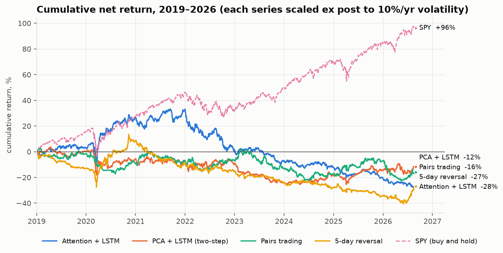
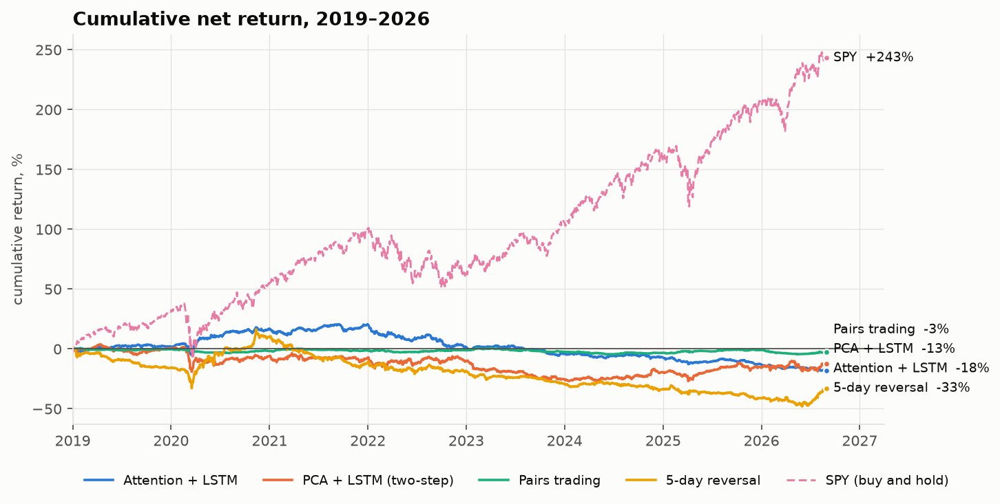
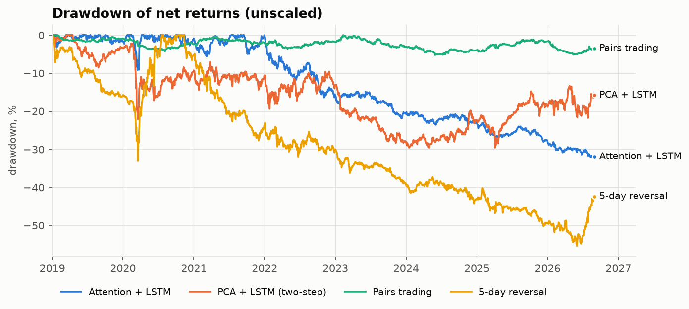
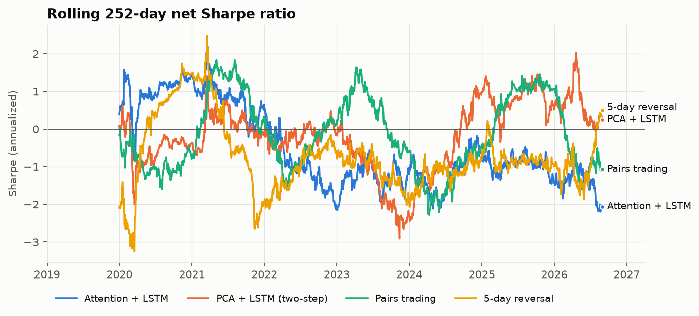
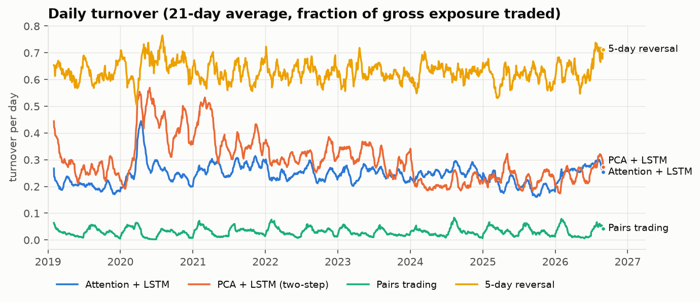
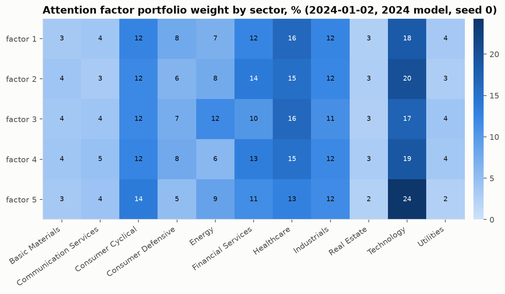
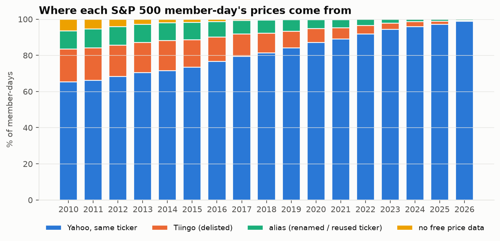

# Attention Factors for Statistical Arbitrage: a reproduction on free data

Simplified reproduction of Epstein, Wang, Choi & Pelger (2025), arXiv:2510.11616. Out-of-sample walk-forward 2019-01-02 → 2026-08-31 (1,927 trading days, 7.7 years) on the 200 most liquid point-in-time S&P 500 members, delisted names included. Configuration frozen on 2017–2018 validation (git tag `frozen-v1`) before any 2019+ data was used; every OOS run is logged in `results/oos_runs.csv`.

## Summary

- **Headline (attention + LSTM, 5-seed ensemble): net Sharpe -0.37, 95% CI [-1.11, +0.34]; gross +0.26.** Costs of 5 bps per unit traded plus 1 bp/day on shorts turn a small gross edge into a loss. With 7.7 years the Sharpe standard error is ≈ 0.36, so none of the strategies is distinguishable from zero or from each other.
- **The paper's central claim does not replicate in this setting:** joint attention factors do not beat the two-step PCA benchmark (difference −0.26, CI [−1.12, +0.53]).
- **Not market-neutral:** market β +0.16 (10.5), about +22% net long on average. The paper's construction is factor-neutral; with only 5 factors and λ_Var = 1 (selected on validation) the factors do not span the market.
- **The attention model worked early and then broke:** net Sharpe positive in 2019–2021, negative every year since 2022 (table T2).
- **Survivorship bias, quantified:** the same frozen model on today's constituents scores -0.02 instead of -0.37 (+0.35).
- **No look-ahead:** see the checks below (bit-identical weights under scrambled future data, null test).

## T1. Out-of-sample results, 2019-01-02 → 2026-08-31

| strategy | SR gross | SR net | 95% CI (net) | μ net %/yr | σ %/yr | max DD % | turnover/day | gross exp. | net $ exp. | β (t) |
|---|---|---|---|---|---|---|---|---|---|---|
| Attention + LSTM | 0.26 | -0.37 | [-1.11, +0.34] | -2.38 | 6.40 | -32.25 | 0.24 | 1.00 | 0.22 | +0.16 (10.5) |
| PCA + LSTM (two-step) | 0.33 | -0.11 | [-0.74, +0.49] | -1.20 | 10.58 | -29.58 | 0.30 | 1.00 | 0.24 | +0.23 (7.6) |
| Pairs trading | 0.23 | -0.18 | [-0.89, +0.55] | -0.36 | 2.00 | -5.26 | 0.03 | 0.33 | -0.01 | +0.01 (1.7) |
| 5-day reversal | 0.38 | -0.36 | [-1.13, +0.36] | -4.47 | 12.34 | -55.38 | 0.63 | 1.00 | 0.00 | +0.14 (4.5) |
| Equal-weight universe (long-only) | 0.89 | 0.89 | [+0.29, +1.66] | 17.79 | 20.00 | -37.11 | 0.00 | 1.00 | 1.00 | +1.00 (53.6) |
| SPY (buy and hold) | 0.93 | 0.93 | [+0.32, +1.68] | 18.00 | 19.31 | -33.72 | 0.00 | 1.00 | 1.00 | +1.00 (by definition) |

Attention + LSTM per-seed net Sharpe: -0.24, -0.24, -0.42, -0.69, -0.71 (mean -0.46 ± 0.23); the headline is their ensemble. Gross exposure is 1 for the model strategies; pairs trading uses committed capital (average gross 0.33).

## T2. Net Sharpe by year

| year | Attention + LSTM | PCA + LSTM (two-step) | Pairs trading | 5-day reversal | SPY (buy and hold) |
|---|---|---|---|---|---|
| 2019 | 0.38 | 0.08 | -0.16 | -2.09 | 2.24 |
| 2020 | 1.45 | -0.36 | -0.78 | 1.47 | 0.67 |
| 2021 | 0.56 | -0.15 | 0.28 | -1.96 | 2.01 |
| 2022 | -2.09 | -0.14 | 0.13 | -0.63 | -0.71 |
| 2023 | -1.23 | -2.34 | -0.60 | -1.89 | 1.86 |
| 2024 | -0.64 | 0.96 | -0.46 | -0.82 | 1.83 |
| 2025 | -1.31 | 0.55 | 1.04 | -0.97 | 0.94 |
| 2026 | -1.65 | 0.47 | -1.30 | 1.26 | 1.45 |

## T3. Robustness: execution lag and costs (OOS net Sharpe)

| scenario | Attention + LSTM | PCA + LSTM (two-step) | Pairs trading | 5-day reversal |
|---|---|---|---|---|
| base: 5 bps, executed at the decision close | -0.37 | -0.11 | -0.18 | -0.36 |
| 1-day execution lag | -0.56 | -0.14 | -0.11 | -0.30 |
| 0 bps trading cost | 0.11 | 0.24 | 0.02 | 0.28 |
| 2 bps trading cost | -0.08 | 0.10 | -0.06 | 0.02 |
| 10 bps trading cost | -0.85 | -0.47 | -0.37 | -1.00 |

Short cost stays at 1 bp/day in every row. Even with zero trading cost no strategy exceeds a net Sharpe of 0.3.

## T4. Ablations (post-freeze; never replace the headline)

| ablation | net SR | 95% CI | gross SR | turnover/day | beta | seed SR mean |
|---|---|---|---|---|---|---|
| headline: LSTM, 15 features, K=5 | -0.37 | [-1.11, +0.34] | 0.26 | 0.24 | 0.16 | -0.46 |
| LongConv instead of LSTM (paper's sequence model) | -1.54 | [-2.29, -0.81] | -0.03 | 0.74 | 0.12 | -1.47 |
| drop past-return features | -0.44 | [-1.12, +0.18] | 0.12 | 0.30 | 0.14 | -0.50 |
| drop risk features | -0.16 | [-0.84, +0.47] | 0.47 | 0.30 | 0.15 | -0.27 |
| drop trading-friction features | -0.25 | [-1.00, +0.48] | 0.44 | 0.32 | 0.17 | -0.40 |
| K = 10 factors | -0.63 | [-1.37, +0.12] | 0.13 | 0.43 | 0.11 | -0.76 |
| K = 20 factors | -1.17 | [-1.80, -0.52] | 0.06 | 0.55 | 0.03 | -1.18 |

More factors raise turnover and hurt net performance — the opposite of the paper, where weak factors helped (their N = 500 vs our 200). LongConv ran with hyperparameters tuned for the LSTM, so it is not a fair verdict on LongConv. Dropping past-return features hurts most, matching the paper's direction.

## T5. The paper vs this build

| model | SR gross | SR net |
|---|---|---|
| Attention factors (paper, K=30, N=500, CRSP 1998–2021) | 3.97 | 2.28 |
| PCA + LongConv two-step (paper, K=30) | 2.79 | 1.57 |
| Attention factors (this build, K=5, N=200, 2019–2026) | 0.26 | -0.37 |
| PCA + LSTM two-step (this build, K=5) | 0.33 | -0.11 |

## T6. Frozen configuration (selected on 2017–2018 validation)

| strategy | frozen settings | valid SR net | valid SR gross |
|---|---|---|---|
| Attention + LSTM | K=5, hidden=16, lambda_var=1.0, lookback=60, lr=0.003 | -0.50 | 0.69 |
| PCA + LSTM (two-step) | K=5, lr=0.003 | -0.21 | 0.52 |
| Pairs trading | entry_z=1.5, max_pairs=40 | -0.27 | 0.29 |
| 5-day reversal | lookback=5 | -1.10 | 0.34 |

The paper's λ_Var = 100 was among the worst settings on validation; λ_Var = 1 won.

## Factor structure

The five factors are nearly the same portfolio: mean pairwise cosine similarity of their weight vectors is 0.938, and each spreads over ~169 of the 200 stocks (effective number 1/Σw²). They are diffuse, technology-tilted, market-like portfolios rather than the distinct industry factors the paper reports (its Fig. 4). With λ_Var = 1 the explained-variance term pushes weakly, and the projection effectively removes one market-like direction — consistent with the remaining market β.

Top-10 names per factor: `f6_top_names.csv`.

## Data coverage

| year | yahoo | tiingo | alias | unrecoverable |
|---|---|---|---|---|
| 2010 | 65.20 | 18.20 | 10.10 | 6.50 |
| 2011 | 66.20 | 18.00 | 10.40 | 5.40 |
| 2012 | 68.30 | 17.30 | 10.20 | 4.20 |
| 2013 | 70.50 | 16.70 | 10.00 | 2.80 |
| 2014 | 71.50 | 16.70 | 9.90 | 1.90 |
| 2015 | 73.40 | 15.20 | 9.60 | 1.80 |
| 2016 | 76.60 | 13.50 | 8.50 | 1.40 |
| 2017 | 79.40 | 12.30 | 7.60 | 0.70 |
| 2018 | 81.30 | 10.90 | 7.40 | 0.40 |
| 2019 | 84.10 | 9.10 | 6.50 | 0.20 |
| 2020 | 87.20 | 7.50 | 5.10 | 0.20 |
| 2021 | 89.10 | 6.10 | 4.60 | 0.20 |
| 2022 | 91.90 | 4.60 | 3.50 | 0.00 |
| 2023 | 94.40 | 3.30 | 2.30 | 0.00 |
| 2024 | 95.90 | 2.70 | 1.40 | 0.00 |
| 2025 | 97.20 | 1.70 | 1.20 | 0.00 |
| 2026 | 98.80 | 0.50 | 0.70 | 0.00 |

## Bias and robustness checks

Generated by `python -m statarb checks` (PLAN.md §13).

### 1. Look-ahead: causality unit tests

39 passed, 0 failed (truncation invariance of features and universe, tensors built from t−1, weights independent of the realized return, engine alignment, planted-signal controls).

### 2. Look-ahead: end-to-end future perturbation on trained OOS models

All raw data dated after t* is replaced with noise; features and tensors are rebuilt; the frozen attention model (seed 0, that year's checkpoint) re-predicts on CPU.

| t_star | max_abs_diff_upto_t_plus_1 | max_abs_diff_t_plus_2 | pass |
|---|---|---|---|
| 2021-02-11 | 0.0000000000 | 0.0198534578 | True |
| 2021-05-27 | 0.0000000000 | 0.0152630890 | True |
| 2022-12-06 | 0.0000000000 | 0.0119580766 | True |
| 2023-11-16 | 0.0000000000 | 0.0144926477 | True |
| 2025-07-01 | 0.0000000000 | 0.0107040703 | True |

### 3. Look-ahead: pure-noise panels (tuning split)

| noise_seed | valid_gross_sr |
|---|---|
| 0 | 0.12 |
| 1 | 0.62 |
| 2 | -1.06 |

Mean validation gross SR -0.11 (pass if |mean| < 1.0).

### 4. Execution lag and cost sensitivity (OOS net Sharpe, 2019-01 → 2026-08)

| scenario | attention | pca | pairs | reversal |
|---|---|---|---|---|
| base: 5 bps, executed at the decision close | -0.37 | -0.11 | -0.18 | -0.36 |
| 1-day execution lag | -0.56 | -0.14 | -0.11 | -0.30 |
| 0 bps trading cost | 0.11 | 0.24 | 0.02 | 0.28 |
| 2 bps trading cost | -0.08 | 0.10 | -0.06 | 0.02 |
| 10 bps trading cost | -0.85 | -0.47 | -0.37 | -1.00 |

### 5. Survivorship

- Member-days 2019+ with price data: 99.91%; universe slots filled by delisted (Tiingo-only) names: 2.74%.
- Frozen attention model, point-in-time universe: net SR -0.37; today's-constituents universe: -0.02.
- Survivor − point-in-time: +0.35 [-0.38, +1.17] (95% stationary-bootstrap CI).

### 6. Halts and failures (SVB, First Republic)

- SVB Financial (tiingo:SIVBQ): 82 valid days Feb 15–Jun 30 2023; largest calendar gap 19 days; moves beyond ±30%: 2023-03-09 -60.4%, 2023-03-28 -99.6%, 2023-03-29 +142.5%, 2023-04-19 +69.2%, 2023-06-15 +54.3%
- First Republic (tiingo:FRCB): 92 valid days Feb 15–Jun 30 2023; largest calendar gap 5 days; moves beyond ±30%: 2023-03-13 -61.8%, 2023-03-17 -32.8%, 2023-03-20 -47.1%, 2023-04-25 -49.4%, 2023-04-28 -43.3%, 2023-05-03 -90.5%, 2023-06-16 +48.4%, 2023-06-28 +76.3%
- tiingo:SIVBQ: in the top-200 universe in 6 months, last 2022-07
- tiingo:SIVBQ on 2023-03-28: position +0.0000 (gross exposure 1), booked return -99.6%, P&L contribution -0.000% of capital
- tiingo:FRCB: in the top-200 universe in 0 months (never liquid enough)
- tiingo:FRCB on 2023-05-03: position +0.0000 (gross exposure 1), booked return -90.5%, P&L contribution -0.000% of capital

## Limitations

- Price/volume characteristics only (no Compustat fundamentals); universe of 200, not 500.
- 7.7 OOS years: Sharpe standard error ≈ 0.36; differences between strategies are not significant.
- Trades assumed at the decision close; linear costs (5 bps + 1 bp short), no market impact or borrow limits.
- Sectors are current, not point-in-time; 43 membership spells (2 overlapping 2019+) have no free price data.
- LSTM instead of the paper's LongConv as the primary sequence model (LongConv reported as an ablation).

## CV bullets (measured numbers)

- Built a simplified reproduction of "Attention Factors for Statistical Arbitrage" (arXiv:2510.11616): cross-sectional attention with learned factor queries over 15 price/volume characteristics produces latent factor portfolios; an LSTM over 60-day factor residuals outputs residual-portfolio weights; both are trained jointly end-to-end on net-of-cost Sharpe (PyTorch).
- Walk-forward backtest with annual retraining, out-of-sample 2019–2026, on the 200 most liquid point-in-time S&P 500 members including delisted names (yfinance + Tiingo, 871 membership spells resolved): gross Sharpe 0.26, net -0.37 after 5 bps + 1 bp short costs, vs -0.11 for a two-step PCA benchmark and -0.18 for cointegration pairs trading — no strategy survives costs in large caps.
- Verified the pipeline: truncation and future-perturbation tests (weights bit-identical when future data is scrambled), a pure-noise null test and a planted-signal control; quantified survivorship bias (a today's-constituents universe inflates net Sharpe by +0.35).
